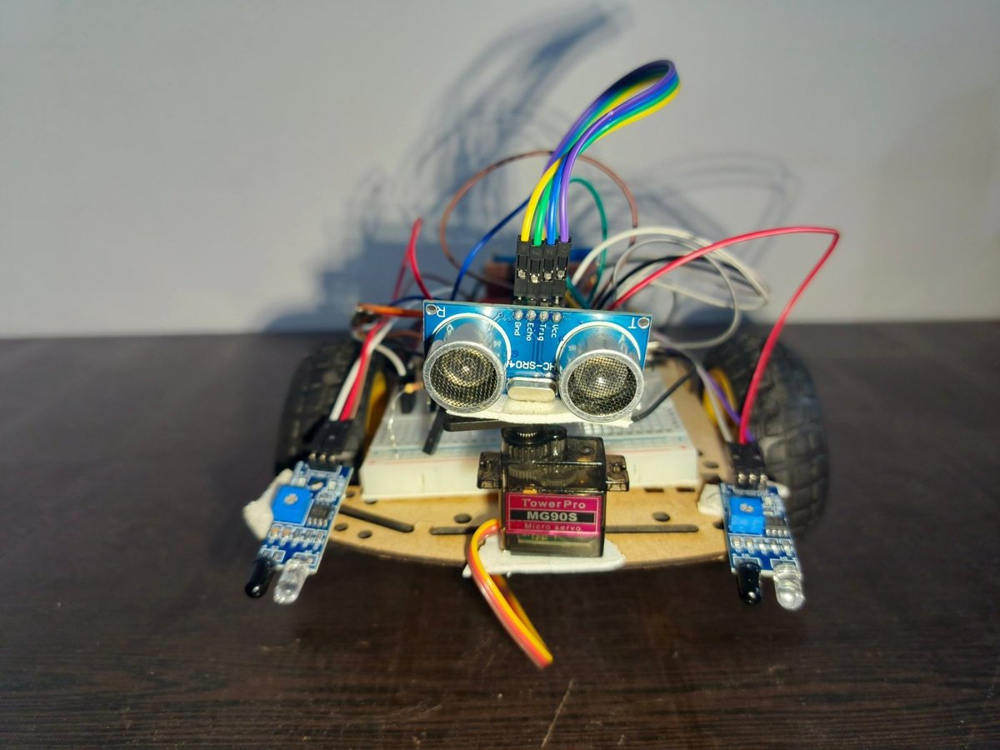
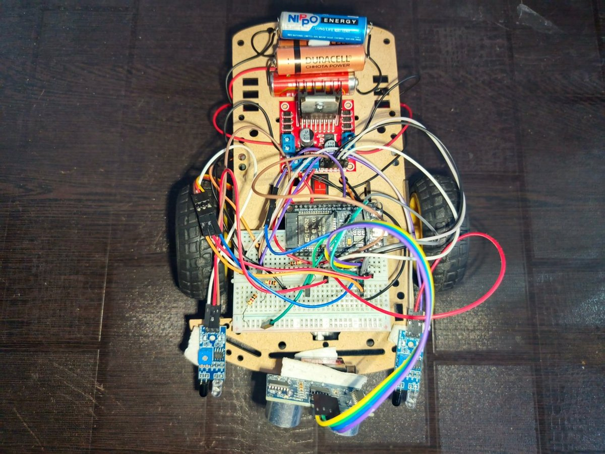
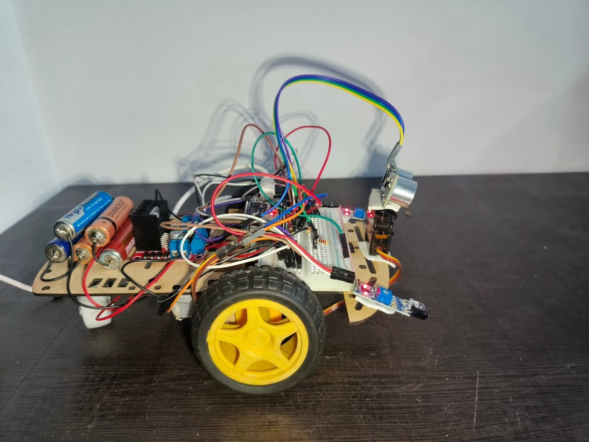
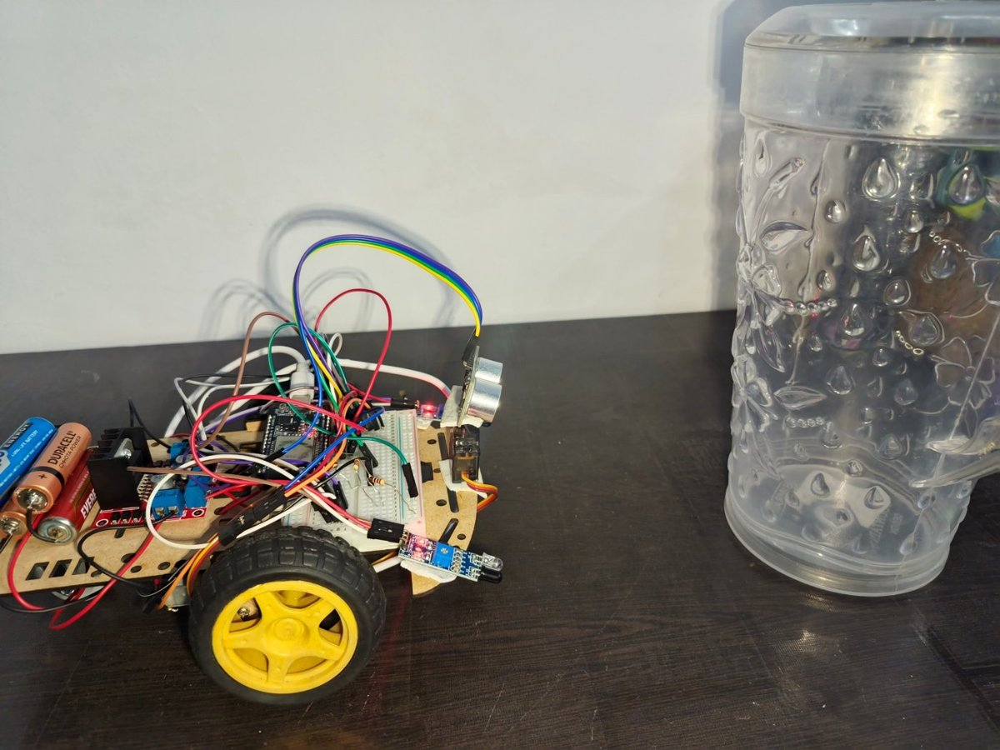
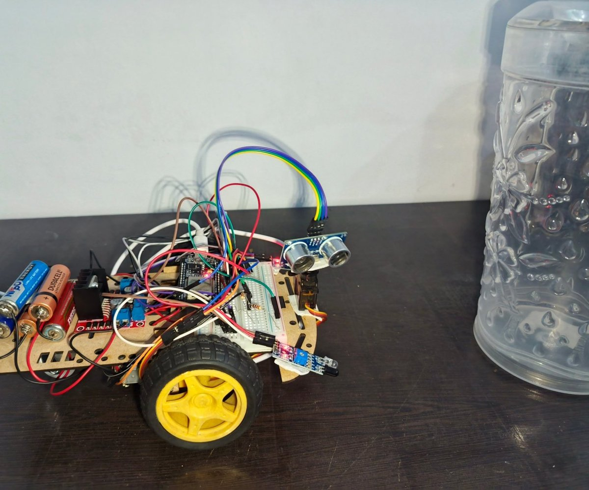
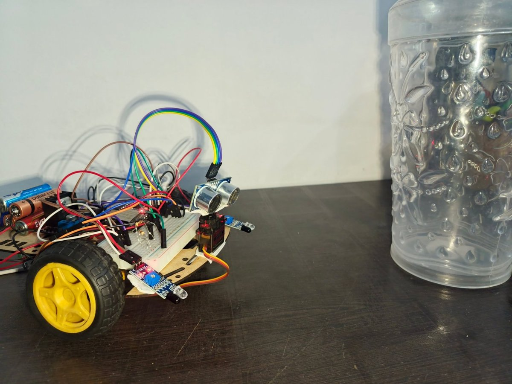
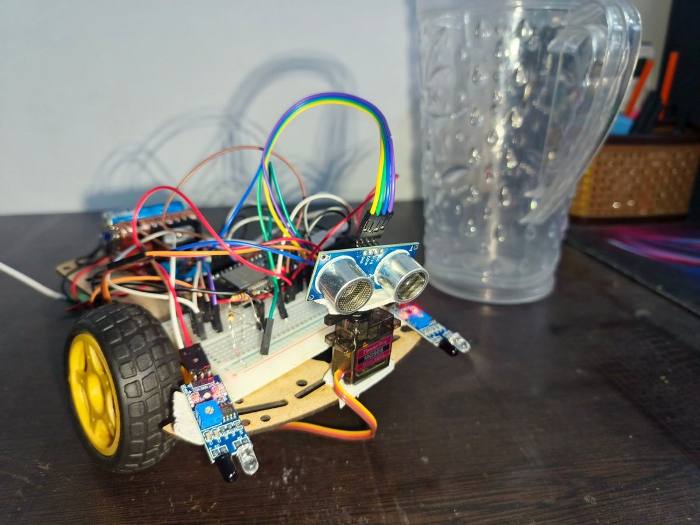

# 🚗 ESP32 Obstacle Avoiding Car

A small robot car that drives by itself and steers around things in its way. An ESP32 board runs everything, an ultrasonic sensor measures the distance to objects, and a servo motor turns the sensor left and right so the car can look for a free path.

---

## 📸 Structure of the car

| Front view | Top view |
|:---:|:---:|
|  |  |

---

## 🧰 Components

| Component | What it does |
|---|---|
| **ESP32 board** | The brain of the car |
| **HC-SR04 ultrasonic sensor** | Measures the distance to objects |
| **MG90S servo motor** | Turns the sensor left and right |
| **IR obstacle sensors** | Detect objects near the front of the car |
| **L298N motor driver** | Controls the wheel motors |
| **2WD chassis with motors** | The body and wheels of the car |
| **Breadboard, jumper wires and batteries** | Connect and power everything |

---

## ⚙️ How it works

1. The car drives straight forward while the way ahead is clear.
2. The ultrasonic sensor sends out sound waves and listens for the echo. The time of the echo tells how far an object is.
3. When an object comes in the path of the car, the sensor detects it and the car stops.
4. The servo motor turns the sensor left and right to look for a new path.
5. When the sensor finds a free path, the car turns that way and starts moving again, away from the object.

---

## 🎬 Working of the car

| Moving forward | Object detected |
|:---:|:---:|
|  |  |
| The way ahead is clear, so the car keeps driving straight forward | An object comes in the path, the sensor detects it and the car stops |

| Looking for another path | Path found |
|:---:|:---:|
|  |  |
| The sensor looks around for a new path | The sensor finds a new path |

| Moving on the new path |
|:---:|
|  |
| The car starts moving on the new path and drives away from the object |

---

## 🔌 Wiring

Fill in the GPIO numbers from your code.

| Part | Part pin | ESP32 pin |
|---|---|---|
| HC-SR04 | Trig | GPIO ? |
| HC-SR04 | Echo | GPIO ? |
| HC-SR04 | VCC / GND | 5V / GND |
| MG90S servo | Signal | GPIO ? |
| L298N | IN1, IN2, IN3, IN4 | GPIO ?, ?, ?, ? |
| L298N | ENA, ENB (if used) | GPIO ?, ? |
| IR sensors | OUT (left, right) | GPIO ?, ? |

**Power:** the batteries power the L298N motor driver (12V terminal). Connect all grounds together (batteries, L298N, ESP32, sensors).

> ⚠️ The Echo pin of the HC-SR04 gives 5V, but the ESP32 pins work at 3.3V. Use a voltage divider (two resistors) on the Echo line to protect the ESP32.

---

## 💻 Setup

1. Install the **Arduino IDE** and add the **ESP32 board package**.
2. Open the sketch from this repository.
3. Install any libraries the sketch needs (for example, **ESP32Servo** for the servo motor).
4. Select your ESP32 board and port, then upload the code.
5. Put the batteries in, place the car on the floor and switch it on.

---

## 🗂️ Project files

```
ESP32_OBSTACLE_AVOIDING_CAR/
├── images/        # photos used in this README
├── (your code)    # ESP32 sketch
└── README.md
```

---

## 🙋 Author

Made by **Aarav** — [github.com/Aarav781](https://github.com/Aarav781)
